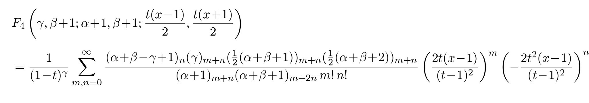

# Cohl's Appell $F_4$ identity

On 2023-09-08, Howard S. Cohl posted [this formula](https://x.com/hcohl001/status/1700261948808700126)
on X and asked whether anyone could prove it. The formula and the image
below are his; the post itself asks "Here's a conjecture. Can anyone prove
it? The F4 function is the Appell F4 double hypergeometric series"
([DLMF 16.13.4](https://dlmf.nist.gov/16.13.E4)).



The image above is Howard S. Cohl's own posted image, reproduced from his
[post](https://x.com/hcohl001/status/1700261948808700126) with credit and
a link to it. It is not covered by this repository's licences; see
[LICENSE-text](LICENSE-text).

## The statement

In LaTeX, with $(a)_j$ the rising factorial:

$$
\begin{aligned}
&F_4\left(\gamma,\beta+1;\alpha+1,\beta+1;
      \frac{t(x-1)}{2},\frac{t(x+1)}{2}\right)\\
&=\frac{1}{(1-t)^\gamma}
  \sum_{m,n=0}^{\infty}
  \frac{(\alpha+\beta-\gamma+1)_n(\gamma)_{m+n}
        \left(\tfrac12(\alpha+\beta+1)\right)_{m+n}
        \left(\tfrac12(\alpha+\beta+2)\right)_{m+n}}
       {(\alpha+1)_{m+n}(\alpha+\beta+1)_{m+2n}\,m!\,n!}
  \left(\frac{2t(x-1)}{(t-1)^2}\right)^m
  \left(-\frac{2t^2(x-1)}{(t-1)^2}\right)^n ,
\end{aligned}
$$

where
$F_4(a,b;c,d;u,v)=\sum_{i,j\ge0}\frac{(a)_{i+j}(b)_{i+j}}{(c)_i(d)_j\,i!j!}u^iv^j$
([DLMF 16.13.4](https://dlmf.nist.gov/16.13.E4)).

## The answer

**True.** The identity holds as a formal power series in $t$ (with
polynomial coefficients in $x$ and rational dependence on $\alpha,\beta,\gamma$),
and as an equality of the two absolutely convergent defining series wherever
both sides converge absolutely. The common open domain for nonterminating
$\gamma$ is $\sqrt{|u|}+\sqrt{|v|}<1$ together with $4|u|<|1-t|^2$, where
$u=t(x-1)/2$ and $v=t(x+1)/2$; the exact boundary conditions and the
terminating case $\gamma\in\{0,-1,-2,\ldots\}$ are worked out in the proof.

The full proof with its convergence analysis is [proof.md](proof.md)
([proof.pdf](proof.pdf) is built from the same text).

## The short proof route

The left side is the generating function
$\sum_{n\ge0}\frac{(\gamma)_n}{(\alpha+1)_n}P_n^{(\alpha,\beta)}(x)\,t^n$
for Jacobi polynomials in its binomial-sum form
([DLMF 18.5.8](https://dlmf.nist.gov/18.5.E8)). Write each
$P_n^{(\alpha,\beta)}(x)$ as a Gauss function
([DLMF 18.5.7](https://dlmf.nist.gov/18.5.E7)) and interchange the two
sums. The coefficient of $\bigl(t(x-1)/2\bigr)^k$ is then a Gauss series
${}_2F_1(\gamma+k,S+2k;S+k;t)$ with an explicit prefactor, where
$S=\alpha+\beta+1$. Euler's transformation
([DLMF 15.8.1](https://dlmf.nist.gov/15.8.E1)) turns it into a terminating
series, and collecting powers with the duplication formula
([DLMF 5.2.8](https://dlmf.nist.gov/5.2.E8)) replaces each collected
factor $(S)_{2k}$ by $4^k\bigl(\tfrac S2\bigr)_k\bigl(\tfrac{S+1}2\bigr)_k$,
which is exactly the posted right side. The proof in
[proof.md](proof.md) does the same computation coefficientwise in the
formal power-series ring, then upgrades it to the convergent case with
full convergence domain, boundary tests, and the terminating case.

## Not a new theorem

The identity follows from standard formulas and is not a new theorem. It
is a five-line consequence of DLMF 18.5.7–18.5.8 combined with Euler's
transformation DLMF 15.8.1 and the duplication formula DLMF 5.2.8. In
that route the only work is bookkeeping: a terminating Gauss series
re-collected into the posted double sum. Equivalently, it is the
repeated-parameter $F_4\to F_1$ reduction of DLMF 16.16
(16.16.5_5 and 16.16.8) followed by the quadratic $F_1\to H_3$ change of
variables, re-collected by the duplication formula. The special case
$\gamma=\alpha+\beta+1$ was published by Cohl and MacKenzie (eq. (7) of
the arXiv PDF/latex source of *Generalizations and specializations of
generating functions*, 2013 revision; the arXiv HTML rendering numbers
the same equation (13)); in that case the inner sum reduces to $n=0$. A
survey of the surrounding literature is part of [proof.md](proof.md).

## How to check

One command, from the root of a clean clone, runs all six checks and
prints `PASS` or `FAIL` for each (a few minutes on one core):

```sh
python3 checks/run_all.py
```

It needs the pinned versions `sympy==1.14.0` and `mpmath==1.3.0`
installed first: `python3 -m pip install -r requirements.txt`. The six
checks are

| Check | What it does |
| --- | --- |
| [`checks/check_numeric.py`](checks/check_numeric.py) | The proof's check: both double series summed literally as printed, per case at 85 and 115 decimal digits with two independent cutoffs. |
| [`checks/check_symbolic.py`](checks/check_symbolic.py) | The proof's check: every coefficient $[t^r\,y^k]$ compared as an exact polynomial over $\mathbb{Q}$ in the parameters. |
| [`checks/check_opus.py`](checks/check_opus.py) | First independent reviewer's check: exact rational coefficients, fully symbolic comparison, 60-digit numerics against the Jacobi generating function and the Horn $H_3$ form, negative controls. |
| [`checks/verify_glm.py`](checks/verify_glm.py) | Second independent reviewer's verification: exact two-variable coefficient comparisons, proof-step identities, 60-digit numerics, the $H_3$ reduction, sensitivity mutations. |
| [`checks/verify_gemini_exact.py`](checks/verify_gemini_exact.py) | Third independent reviewer's exact check: the literal (uncancelled) right side against the defining $F_4$ series in exact rational arithmetic, polynomial-in-$x$ coefficients, the $H_3$ form, and four planted errors that must be caught. |
| [`checks/verify_gemini_numeric.py`](checks/verify_gemini_numeric.py) | Third independent reviewer's numeric check: 110-digit decimal-complex summation of both literal series, the removable $S$-pole case, boundary and conditional-convergence diagnostics, planted errors. |

Each program defaults to a reduced size so the suite finishes quickly;
`--full` (or `--order 40` for `check_symbolic.py`) regenerates the
saved logs [`checks/numeric.txt`](checks/numeric.txt),
[`checks/symbolic.txt`](checks/symbolic.txt),
[`checks/opus-output.txt`](checks/opus-output.txt) and
[`checks/glm-output.txt`](checks/glm-output.txt). The two Gemini programs
already run at full size; their logs
[`checks/gemini-exact-output.txt`](checks/gemini-exact-output.txt) and
[`checks/gemini-numeric-output.txt`](checks/gemini-numeric-output.txt)
are always reproduced.

## Who did what

- **Statement and image:** Howard S. Cohl, [posted 2023-09-08](https://x.com/hcohl001/status/1700261948808700126).
- **Proof:** GPT-6.2 Sol ([proof.md](proof.md)). It answers the question
  Cohl posted; it does not establish a new theorem.
- **Independent exact checks:** Claude Opus 5.5
  ([review](reviews/cohl-opus.md), [code](checks/check_opus.py)), GLM 5.3
  ([review](reviews/cohl-glm.md), [code](checks/verify_glm.py)), and
  Gemini 4 Neon ([review](reviews/cohl-gemini.md),
  [code](checks/verify_gemini_exact.py)) — each written from the posted
  statement only, with its own code. The Gemini 4 Neon review was
  conducted without seeing the other two reviews.

## Repository layout

- [`proof.md`](proof.md) / [`proof.pdf`](proof.pdf) — the proof and the
  literature survey, with computational-check description.
- [`checks/`](checks/) — the six check programs, `run_all.py`, and the
  saved full-size logs.
- [`reviews/`](reviews/) — the three independent review reports, as
  written.
- `cohl-f4.jpg` — Cohl's posted image (his image, reproduced with
  credit and a link to his post; not covered by the repository's
  licences).
- [`LICENSE`](LICENSE) — MIT, for the code.
  [`LICENSE-text`](LICENSE-text) — CC BY 4.0, for the text and the proof.
